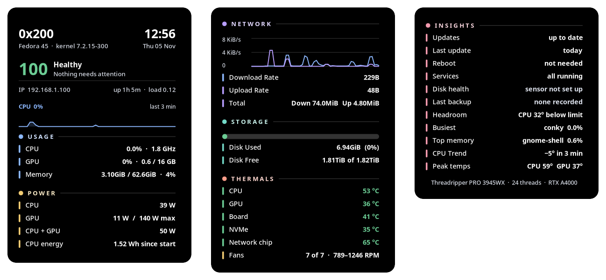

# Polaris

[](https://copr.fedorainfracloud.org/coprs/fr3on/polaris/package/polaris/)

<p align="center"></p>

**See how your Linux machine is doing at a glance.** Polaris is a transparent widget that sits on your desktop and tells you in plain words if everything is fine, and what needs attention if it is not.

## What it shows

| Section | What you get |
|---|---|
| Health | A score out of 100, a one-line verdict, clock, IP, uptime, load, CPU graph |
| Usage | CPU, GPU and memory |
| Power | CPU and GPU watts, and energy used since start |
| Network | Live download and upload graph, rates, session totals |
| Storage | Disk bar with used and free space |
| Thermals | CPU, GPU, board, NVMe and network chip temperatures, fan speeds |
| Insights | Pending and security updates, reboot needed, failed services, NVMe wear, last backup, busiest processes |

The score drops when something needs care (a hot part, a stopped fan, a failed service, a security update, a worn disk). The header then names the problem.

**Settings window and auto-fit.** Open *Polaris* from your app menu (or run `polaris --settings`) to change size, speed, °C or °F, which sections show, alert limits and start at login. The widget also sizes itself to your screen, so it always fits, from a laptop to a 4K monitor.

Nothing is hardcoded to one machine. Sensors, network interface, GPU, fans and disks are found automatically, and rows for hardware you do not have are hidden.

## Install

### Fedora (RPM)

```bash
git clone https://github.com/fr3on/polaris && cd polaris
./build.sh                                  # needs rpm-build
sudo dnf install ./out/polaris-*.rpm        # dnf installs the dependencies for you
```

### Fedora (COPR)

```bash
sudo dnf copr enable fr3on/polaris
sudo dnf install polaris
```

### Ubuntu and Debian (.deb)

Download `polaris-widget_*_all.deb` from the [latest release](https://github.com/fr3on/polaris/releases/latest), then:

```bash
sudo apt install ./polaris-widget_1.0.0-1_all.deb     # apt installs the dependencies for you
```

The widget works on any current Ubuntu or Debian. The settings window needs libadwaita 1.4 or newer (Ubuntu 24.04 or Debian 13 and later); on older releases the widget still runs and you can change settings in `~/.config/polaris/settings.conf`.

### Arch (manual, until the AUR package is live)

```bash
git clone https://github.com/fr3on/polaris && cd polaris/packaging/aur && makepkg -si
```

### Any other distro (Debian, Ubuntu, Arch, openSUSE)

```bash
git clone https://github.com/fr3on/polaris && cd polaris
./install.sh                                # installs the dependencies, then Polaris
```

`install.sh` detects `dnf`, `apt`, `pacman` or `zypper` and installs what is missing. Use `NODEPS=1` to skip that, `PREFIX=/usr` to change the location, and `DRYRUN=1` to see what it would do.

Then log out and in, or run `polaris &`.

### Dependencies (installed for you)

| Needed | Why |
|---|---|
| `conky` with Lua and Cairo | draws the widget (on Debian and Ubuntu this is `conky-all`) |
| `python3`, `libX11` | the launcher: dragging, size, refresh |
| `nvme-cli` | NVMe health and wear |
| `python3-gobject`, `gtk4`, `libadwaita` | the settings window |
| `lm_sensors` (recommended) | temperature and fan drivers |

Optional: an NVIDIA driver (`nvidia-smi`) adds GPU rows. Update checks need `dnf`.

## Use

- **Move it:** hold Super and drag with the left mouse button. The spot is remembered.
- **Open it from the app menu:** search for *Polaris*. It opens the settings window and makes sure the widget is on your desktop.
- **Settings window:** `polaris --settings`, or *Polaris* in the app menu. It has General, Sections, Alerts and About tabs.
- **Resize:** automatic by default. `polaris --size 125` sets a fixed size (50 to 200 percent), `polaris --size auto` goes back to automatic.
- **Update speed:** `polaris --refresh 5` (1 to 60 seconds).
- **Reset position:** `polaris --reset`.
- **Check your setup:** `polaris --doctor` lists what was found and what is missing, with the fix.
- **Last backup row:** make your backup job run `touch ~/.last-backup`.

Settings live in `~/.config/polaris/` (`settings.conf` is plain `key=value`, so you can edit it by hand).

## How it works

Conky draws a Lua and Cairo canvas with no background. A small launcher keeps it where you put it and reloads it when you change a setting. NVMe health needs root, so a tiny systemd timer (`polaris-smart`) copies the disk log to `/run/polaris-smart` every 15 minutes, and the widget reads that file as a normal user.

## Troubleshooting

- **Black box instead of transparent:** you need a compositing desktop. GNOME, KDE and most others have one. On Wayland, Polaris runs through XWayland.
- **No temperatures or fans:** install `lm_sensors` and run `sudo sensors-detect`. Some boards need an extra driver (for example `nct6687d`). `polaris --doctor` shows what is found.
- **Disk health says "sensor not set up":** run `sudo systemctl enable --now polaris-smart.timer`.
- **Wrong network interface:** Polaris uses the one with the default route.

## Remove

```bash
sudo dnf remove polaris            # RPM
./install.sh --uninstall           # install.sh
```

## License

MIT. See [LICENSE](LICENSE).
